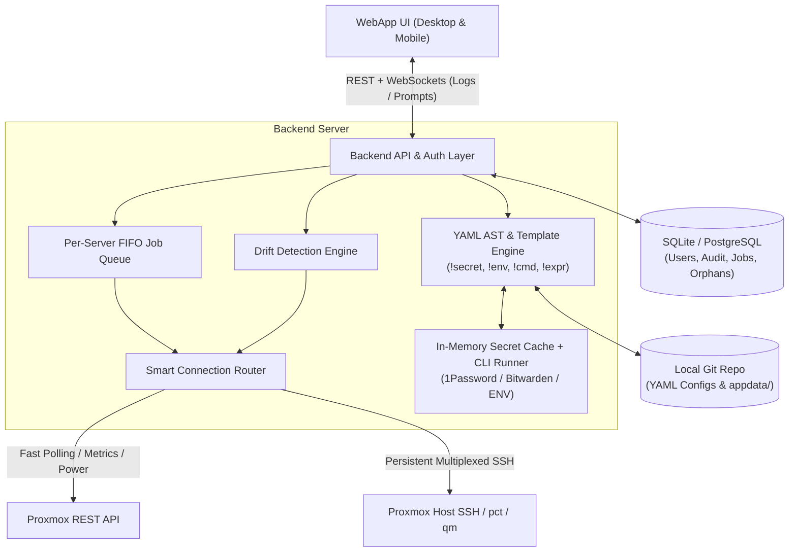

# Proxmox & Homelab Manager — Specification

A WebApp and Backend to manage multiple Proxmox instances (and Docker instances in the future) using local, Git-versioned YAML files. Replaces the current Ansible-based setup.

---

## Architecture & Core Design Decisions

### 1. Configuration Format: Home Assistant–Style Extended YAML (with Comment Preservation)

- **Why YAML:** Supports deep hierarchies cleanly and provides native **Custom Tags** (`!secret`, `!env`, `!cmd`, `!expr`, `!include`) just like Home Assistant.
- **Comment & Tag Preservation:** The backend uses a **Concrete Syntax Tree (CST) / AST-preserving YAML parser** (`eemeli/yaml`). When updating a field from the UI or via "Pull from Live" (e.g., changing `ram: 2048` to `ram: 4096`), only that specific scalar node in the AST is mutated. All comments, blank lines, key ordering, and `!secret` / `!expr` tags remain 100% intact.

#### Example Node Configuration (`112-adguard.yaml`)

```yaml
id: 112
name: adguard
type: lxc

# Merges automatically with ../default-deployment.yaml
host:
  cpu: 2
  ram: 4096 # Updated from live drift check
  disk: 10
  hostname: adguard
  protection: true

network:
  - bridge: vmbr0
    ip: 192.168.1.112/24
    gateway: !env DEFAULT_GATEWAY
    # Computed MAC: A2:B1:C1 (fixed) : 01 (host_id) : E0 (eth0) : 12 (vmid - 100 in decimal)
    mac: !expr "f'A2:B1:C1:{host.index:02d}:E{net.index}:{vmid - 100:02d}'"

ssh:
  enabled: true
  password: !cmd "op read 'op://Homelab/Proxmox-LXC/password'"
  authorized_key: !secret lxc_ssh_pub_key

installation:
  url: https://raw.githubusercontent.com/community-scripts/ProxmoxVE/main/ct/adguard.sh
  answers: ['n', 'n']
  identity_checks:
    - 'test -d /opt/AdGuardHome'
  update_commands:
    - '/opt/AdGuardHome/AdGuardHome -s stop && /opt/AdGuardHome/AdGuardHome -s start'
```

### 2. Application State Database

- Users, sessions, permissions, execution queues, job logs, and audit history are stored in **SQLite** by default, with configurable support for **PostgreSQL**.

### 3. Connection Strategy & Persistent Sessions

- Supports **SSH** (key or password) and **Proxmox API** per instance.
- **SSH is mandatory for full management** (host filesystem manipulation, `pct push/pull`, raw LVM checks, community scripts), while **API is prioritized for fast polling, metrics, and power/resource queries**, with automatic fallback between the two.
- The backend maintains **one persistent SSH connection pool / active console per Proxmox server** so commands execute immediately without reconnect overhead.

### 4. Execution Queue (Concurrency Control)

- Each Proxmox server has **one dedicated FIFO action queue**.
- All mutating operations (create, update, file sync, drift reconciliation, backup/restore) targeting the same Proxmox server are queued and executed sequentially to prevent race conditions.

### 5. Secret Safety on File Sync (`fetch`)

- Keep `compose.yaml` and application config files free of inline plaintext secrets by referencing `${VAR}` and storing secrets strictly in `.env` files.
- Track `.env.template` (or `.env.yaml` with `!secret` / `!cmd` tags) in Git, or gitignore `.env` alongside `.env.example`. At deploy time, the backend renders the resolved `.env` directly into the target container/VM without writing plaintext secrets to Git-tracked files.

### 6. Future Docker Management Boundary

- GitOps Compose Manager approach: keep `compose.yaml` files in the local repo (with `!secret` / `!env` support), sync them to the target Docker host (whether inside a Proxmox LXC, a VM, or a standalone Docker host), and provide native UI controls for `docker compose up/down/logs/pull`, container health, and image updates.

### 7. Git Integration

- Out of scope for now (handled externally by the user via CLI/IDE).

---

## Technology & System Architecture

### 1. Recommended Tech Stack

- **Language & Runtime:** TypeScript (Node.js / Bun) across the full stack for shared types, validation schemas (`zod`), and native CST YAML manipulation (`eemeli/yaml`).
- **Backend Framework:** Fastify or Hono (REST API + WebSockets / Server-Sent Events for real-time job logs, queue updates, and interactive prompts).
- **Database & ORM:** Drizzle ORM or Prisma supporting **SQLite** (`better-sqlite3` / `libsql` default) and **PostgreSQL** via a single connection string config.
- **SSH & Proxmox Clients:**
  - `ssh2` for multiplexed, persistent SSH connection pooling, SFTP file transfers, and interactive shell streams per Proxmox host.
  - Native `fetch` client for the Proxmox VE REST API (`/api2/json/...`) using API Tokens or Ticket auth.
- **Frontend Framework:** React (Vite / Next.js SPA) or Vue 3 with TailwindCSS + shadcn/ui for a clean, responsive Desktop & Mobile dashboard.
- **Diff & Code Editor:** Monaco Editor (or CodeMirror 6) for viewing YAML configs and side-by-side drift/conflict diffs.

### 2. High-Level Architecture Diagram



### 3. Backend Module Breakdown

- **`config-engine` (YAML CST Parser & Evaluator):**
  - Loads `default-deployment.yaml` and merges with node `<vmid>-<name>/deployment.yaml`.
  - Resolves custom tags (`!env`, `!secret`, `!cmd`, `!expr`, `!include`) at runtime while keeping the raw CST document in memory for comment-preserving writes when pulling drift changes back to disk.
- **`secret-manager` (Vault & CLI Resolver):**
  - Executes external CLI commands (`op`, `bw`, etc.) and caches resolved values in memory with a TTL.
  - Detects locked vault states and emits a WebSocket event to prompt the user for unlock credentials in the UI.
- **`connection-manager` (SSH Pool + API Router):**
  - Maintains persistent, keep-alive SSH sessions per Proxmox host (`ssh2` multiplexed channels).
  - Routes each operation based on a capability matrix: uses Proxmox API for fast state/metric polling and SSH for host-level commands (`pct`, `qm`, `debugfs`, `setfacl`, `vzdump`, file staging).
- **`queue-worker` (Per-Host FIFO Executor):**
  - Runs one independent async FIFO queue per Proxmox server.
  - Streams stdout/stderr line-by-line over WebSockets and persists logs to SQLite/PostgreSQL so users can close the browser or switch devices at any time.
  - Supports **pausable jobs** (`WAITING_FOR_USER`) when a file conflict (`prompt`) or split-brain alert requires user input.
- **`reconciler` (Drift & Lifecycle Engine):**
  - Periodically or on-demand fetches live state (`pct config`, `qm config`, SHA256 file hashes) and compares against evaluated YAML configs.
  - Produces structured diffs for the UI with two actions: `applyToHost()` (YAML -> Live) or `applyToYaml()` (Live -> YAML CST).
- **`storage-guard` (`mp0` & File Sync Engine):**
  - Handles LXC `/opt` bind mount creation, UID/GID `100000:100000` shifting, POSIX ACLs, `debugfs` raw LVM rootfs checks, and container mount namespace verification.
  - Handles `appdata/` staging, SHA256 conflict checks, archive extraction, and `.env.template` rendering.

### 4. Proposed Repository & Data Layout

```text
/
├── app/                                  # WebApp + Backend source code
├── db/                                   # SQLite database file (gitignored)
└── data/                                 # Git-tracked Infrastructure Repo
    ├── secrets.yaml                      # Gitignored local secrets (created from secrets.yaml.example)
    ├── global-tasks/                     # Tier 1: Global tasks across all hosts
    │   └── 00-base-packages.yaml
    └── servers/
        └── proxmox01/
            ├── server.yaml               # Connection settings (IP, Host ID=01, SSH/API refs)
            ├── default-deployment.yaml   # Hypervisor-level defaults (CPU, RAM, net, SSH)
            ├── default-filemappings.yaml # Hypervisor-level file mapping defaults
            ├── tasks/                    # Tier 2: Hypervisor-level tasks
            │   ├── 01-postinstall.yaml
            │   └── 02-backups.yaml
            └── 112-adguard/
                ├── deployment.yaml       # Node hardware, net, installation, identity_checks
                ├── filemappings.yaml     # Node file sync & archive mappings
                ├── appdata/              # Source files synced into the guest
                └── tasks/                # Tier 3: Guest post-sync tasks (compose up, systemctl)
```

### 5. Database Schema Overview (SQLite / PostgreSQL)

- **`users`**: `id`, `username`, `password_hash`, `auto_grant_new_servers` (bool), `created_at`
- **`user_server_access`**: `user_id`, `server_id` (maps which Proxmox instances a user can access)
- **`servers`**: `id`, `name`, `host_index`, `connection_status`, `vault_status`
- **`orphaned_resources`**: `server_id`, `vmid`, `type` (`lxc`|`vm`), `status` (`pending` | `ignored`)
- **`jobs`**: `id`, `server_id`, `vmid`, `type`, `status` (`queued` | `running` | `waiting_input` | `completed` | `failed`), `triggered_by`, `logs`, `created_at`, `finished_at`
- **`audit_logs`**: `id`, `user_id`, `server_id`, `vmid`, `action`, `reason` (`manual` | `drift_push` | `drift_pull` | `schedule`), `diff_json`, `timestamp`

---

## Core Features

### 1. Multi-Instance & Smart Connection Routing

- Manage multiple Proxmox instances (with future extensibility for Docker hosts).
- Connect via SSH (key or password), Proxmox API, or both.
- Automatically select the best available connection method for each specific action (API for status/metrics, persistent SSH session for guest execution and filesystem operations) and fall back if needed.

### 2. Hierarchical Local YAML Configuration & Inheritance

- Store all configurations locally in YAML for Git versioning.
- Support **hypervisor-level defaults** (`default-deployment.yaml`, `default-filemappings.yaml`) that automatically merge with **node-level overrides** so common settings are never duplicated across VMs/LXCs.
- Support Home Assistant–style `!include` tags for splitting or sharing task lists and common blocks.
- Automatically initialize untracked local secret/environment files (`.env`, `secrets.yaml`) from committed `.example` templates during bootstrap.

### 3. Dynamic Secret Expansion & Interactive Vault Unlock

- Support custom YAML tags to resolve secrets at runtime:
  - `!env VAR_NAME` — Reads from backend environment variables or node `.env` files.
  - `!secret key_name` — Reads from a local gitignored `secrets.yaml` file.
  - `!cmd "command"` — Executes a configured secret manager CLI command (e.g., `op read ...`, `bw get password ...`, `vault kv get ...`).
- **Interactive CLI Unlock:** If a secret manager CLI requires authentication or master password unlock, the WebApp prompts the user in the UI to unlock the session.
- **In-Memory Secret Cache:** Resolved secrets are cached in memory with a configurable TTL so background drift checks do not repeatedly spawn CLI processes.
- Never write resolved plaintext secrets back to Git-tracked YAML files.

### 4. Dynamic Field Templates & Functions (`!expr`)

- Support computed expressions and helper functions in YAML fields via `!expr`.
- Built-in context variables: `host.id`, `host.index`, `host.name`, `vmid`, `node.name`, `net.index`, `net.bridge`, etc.
- Example: Deterministic MAC address generation (`A2:B1:C1:01:E0:12`), where `A2:B1:C1` is fixed, `01` is `host.index`, `E0` is `eth0`, and `12` is `vmid - 100` formatted as two-digit decimal (`112 -> 12`, `110 -> 10` instead of hex `0A` for human readability).

### 5. State Awareness & Safe Lifecycle Management

- Track live state across Proxmox hosts, VMs, and LXC containers.
- Create, update, and remove resources on the fly while enforcing strict data-safety rules:
  - **Existence checks** via `/etc/pve/local/lxc/<vmid>.conf` and `/etc/pve/local/qemu-server/<vmid>.conf`.
  - **Additive-only disk resizing** (expand disks when config increases; never shrink disks automatically).
  - **Multi-NIC lifecycle:** Configure `net0`, `net1`, etc. (bridge, IP/CIDR, gateway, VLAN, MTU, IPv6 mode) and automatically remove redundant `netX` interfaces removed from YAML.

### 6. Orphaned / Unmanaged Resource Handling

- When the backend discovers a VM or LXC on a Proxmox server that has no corresponding local YAML file, it prompts the user with three choices:
  1. **Import to YAML:** Generate the local YAML file from the live Proxmox config.
  2. **Delete:** Safely remove the resource from Proxmox (with confirmation).
  3. **Flag as Orphan (Ignore):** Mark the VMID as ignored in the database so the manager never touches or prompts about it again.

### 7. Unattended Provisioning (Community Scripts & Templates)

- Provision new LXCs and VMs using remote installation scripts (e.g., Proxmox VE Community Scripts) or standard OS templates.
- Automatically pipe pre-configured `answers` to interactive `read` prompts and inject environment variables (`TERM=xterm`, `var_ctid`, `var_unprivileged`, `var_cpu`, `var_ram`, `var_disk`, `var_brg`, `var_net`, `var_ssh`, etc.).

### 8. Workload Identity Verification (Anti-Collision Guards)

- Support per-node `identity_checks` (shell commands executed inside the guest, e.g., `test -d /opt/AdGuardHome` or `command -v docker`).
- Run identity checks before any update, file sync, or backup. If a VMID exists on the host but fails its identity check, **halt immediately** to prevent overwriting a different workload occupying the same VMID.

### 9. LXC Persistent Bind Mounts (`mp0`) & Split-Brain Prevention

Manage host-backed persistent storage (`/opt/server-data/<node>/<hostname>/opt` mounted at `/opt` inside LXC via `mp0`).

#### Why the `mp0` Issue Happens in Proxmox

1. **Unprivileged UID/GID Shifting:** Unprivileged LXC containers map container `root` (`0:0`) to host `100000:100000`. If the host directory `/opt/server-data/.../opt` is created by host `root` (`0:0`) without shifting, the container sees `nobody:nogroup` and fails with `Permission denied`.
2. **Pre-Mount Rootfs Shadowing:** Community scripts create the container, start it, and install software into `/opt` (inside the container's LVM rootfs disk `vm-<id>-disk-0`) _before_ `mp0` is attached.
   - If you attach `mp0` right after creation without migrating those files first, the empty host directory mounts **over** `/opt`, hiding ("shadowing") the newly installed app files on the rootfs disk and breaking the app.
   - Conversely, if an old rootfs still has stale files under `/opt` and `mp0` ever fails to mount, the container silently boots and writes into the underlying rootfs disk instead of the host path, creating a **split-brain** where both disks have diverging data.
3. **Hot-Plug `[PENDING]` & Mount Namespace Desync:** If `pct set <vmid> -mp0 ...` is run while a container is running (or if the host path is modified), Proxmox may put `mp0` into `[PENDING]` in `<vmid>.conf`, or long-running child daemons inside the container (`dockerd`, `containerd`, `postgres`) may keep a stale Linux mount namespace pointing to the old mount or underlying rootfs.

#### How the New WebApp Avoids & Solves It By Design

1. **Pre-Attachment Hook on Creation (Zero-Shadowing Provisioning):**
   - When creating a new LXC, the backend prepares the host directory (`/opt/server-data/<node>/<hostname>/opt`) with `chown 100000:100000`, `chmod 2777`, and default POSIX ACLs (`setfacl -d -m u::rwx,g::rwx,o::rwx`) _before_ provisioning.
   - If using a standard OS template, `mp0` is attached at creation time (`pct create --mp0 ...`) before first boot, completely eliminating rootfs writes.
   - If using a Community Script (which creates and boots the CT internally), the backend immediately stops the CT after script completion, mounts the raw rootfs (`pct mount`), moves any initial `/opt` files to the host directory (`rsync -aAXH`), shifts any `0:0` files to `100000:100000`, wipes the raw rootfs `/opt` clean, attaches `mp0`, and starts the CT—all as one atomic provisioning step before any app data or Docker stacks run.
2. **Never Hot-Apply `mp0` Without a Controlled Restart:**
   - The backend never applies `mp0` changes to a running container without stopping/restarting it and verifying `[PENDING]` is empty in `/etc/pve/local/lxc/<vmid>.conf`.
3. **Continuous Invariant & Split-Brain Check:**
   - Before syncing files or starting stacks, the backend verifies via `debugfs` (inspecting the raw LVM rootfs block device directly) and `findmnt -M /opt` + `/proc/<pid>/mountinfo` (checking `dockerd`/`containerd`/`postgres` inside the CT) that:
     - Raw rootfs `/opt` is completely empty.
     - `mp0` is actively mounted to the host path in the container and all child daemon namespaces.
   - If a split-brain or shadowed file state is ever detected on an existing container, the job pauses and presents a clear UI resolution modal (showing file counts and newest timestamps on both sides) so the user can choose **"Keep Host Data"** or **"Migrate Rootfs to Host"** (automatically backing up the displaced side first).

### 10. Application Data & File Sync Engine (`filemappings.yaml`)

- Deploy files from the local node directory (`appdata/`) into LXC containers (`pct push`/`pct pull`) and VMs (`qm guest exec` / SFTP):
  - **Single files:** Copy with file permissions (`mode`).
  - **Archives:** Push `.zip`, `.tar.gz`, `.tgz`, `.tar.bz2`, `.tar.xz` and extract inside the guest.
  - **Directory Synchronization:** Bulk-sync directories (`rsync` + tar streaming) with optional `delete` of extraneous files.
  - **Secret Template Rendering:** Render `.env.template` files containing `!secret` / `!cmd` tags directly into the target container's `.env` at deploy time while keeping `compose.yaml` and app configs clean using `${VAR}` references.
- **Conflict Resolution:** Compare SHA256 checksums before overwriting. Support policies: `overwrite`, `skip`, `fetch` (pull remote file back to local repo), or `prompt` (queue a UI prompt asking the user how to resolve the diff).

### 11. Three-Tier Execution Cascade (Tasks & Hooks)

Execute ordered setup/maintenance commands across three levels:

- **Tier 1 (Global):** Runs across all Proxmox hosts (e.g., base monitoring/utility packages).
- **Tier 2 (Hypervisor):** Runs on a specific Proxmox host (e.g., `acl`, `e2fsprogs`, `rsync`, `/etc/vzdump.conf` schedule templates, host-level Restic backup cron jobs).
- **Tier 3 (Node/Guest):** Runs inside a specific LXC (`pct exec <vmid> -- bash -c '...'`) or VM (`qm guest exec <vmid> -- bash -c '...'`) after file sync (e.g., `docker compose up -d --remove-orphans`, `systemctl enable --now`, custom service setup).

### 12. Guest OS Baseline, Package Updates & SSH Bootstrapping

- **OS Detection:** Identify guest OS (`/etc/os-release` — Debian, Ubuntu, Alpine).
- **IPv6 Enforcement:** Enable or disable OS-level IPv6 via `/etc/sysctl.d/99-disable-ipv6.conf`.
- **System & App Updates:** Run unattended OS package updates (`apt-get upgrade` / `apk upgrade`) and custom application `update_commands` (e.g., `PHS_SILENT=1 update`).
- **SSH Bootstrapping & Credential Sync:** Test guest port 22 reachability; if unreachable, automatically install and enable `openssh-server` via `pct exec` / `qm guest exec`. Idempotently sync `root` password (checking `/etc/shadow` hash) and `/root/.ssh/authorized_keys`.

### 13. Pre-Update Backups (`vzdump`), Restore & Offsite Backups (`restic`)

- Automatically trigger `vzdump` snapshot backups (`--mode snapshot --compress zstd`) with structured labels (`VMID_YYYY-MM-DD_HH-MM-SS_AppName`) before updates (configurable via `backup_skip` and `backup_storage`).
- Support one-click container/VM restore (`pct restore` / `qmrestore`) from the UI.
- Manage host-level offsite backup scripts and cron schedules (`restic`).

### 14. Bidirectional Drift Detection & Reconciliation

- Continuously or on-demand compare live Proxmox + guest state (CPU, RAM, disk, NICs, features, tags, protection, synced files) against local YAML files.
- Clearly display drift diffs in the UI (e.g., RAM manually changed from `2048` to `4096` on Proxmox).
- Allow one-click resolution per item or in bulk:
  - **Enforce YAML -> Live:** Apply the local YAML configuration to the running Proxmox resource.
  - **Pull Live -> YAML:** Update the local YAML file (via AST manipulation so comments and `!secret`/`!expr` tags are preserved) to match the live running state.

### 15. Asynchronous Backend & Multi-Device Session Continuity

- All operations run asynchronously in the backend's per-server FIFO queue.
- Users can close the browser or switch from Desktop to Mobile and reconnect to live-streaming logs, job progress, and pending conflict/orphan prompts.

### 16. Multi-User Access Control & Auditability

- **Access Control:** Multiple user accounts with per-Proxmox-instance access assignment, plus a boolean setting for automatic access to newly added Proxmox instances.
- **Audit Log:** Every action and change is logged in SQLite/PostgreSQL with **what** changed (diff), **who** triggered it, **when** it occurred, and **why** (manual action, drift pull/push, scheduled run, conflict resolution).

### 17. Responsive UI/UX (Desktop & Mobile)

- Modern, clean, professional dashboard with dedicated modules:
  - **Overview / Servers:** Host health, persistent connection status, active queue status, and secret CLI lock status.
  - **Resources (LXC / VMs):** Live state, quick actions, console, backups, and orphan alerts.
  - **Drift & Sync Center:** Visual side-by-side diffs for hardware config and `filemappings` conflicts with one-click push/pull buttons.
  - **Docker Compose Stacks (Future Module):** Native UI controls for `docker compose up/down/logs/pull` backed by the Git-tracked `compose.yaml` files.
  - **Jobs & Queue:** Live log streaming and FIFO queue inspection per server.
  - **Audit Log & Users:** Filterable history of all changes and user instance permissions.
